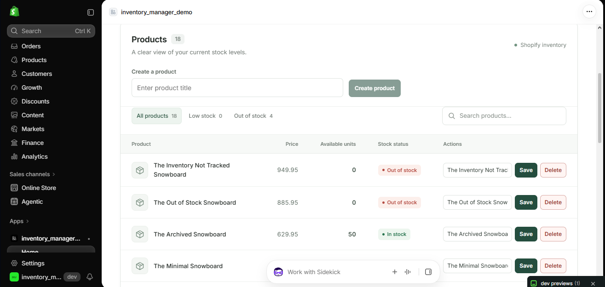

# Shopify Inventory Manager

Shopify Inventory Manager is a small embedded Shopify app prototype for viewing product stock at a glance. It loads up to 100 products from a development store through the Shopify Admin GraphQL API, summarizes inventory health, and provides a searchable, filterable product table with client-side CSV export.

> **Project status:** This is a development-store prototype for demonstration and portfolio purposes. It is not a published Shopify App Store application.



## Tech stack

- **Shopify React Router** (`@shopify/shopify-app-react-router`) for embedded app authentication, routing, and Shopify integration
- **React 18** and **TypeScript** for the UI and server route modules
- **Shopify Admin GraphQL API** for product titles, prices, statuses, and total inventory
- **Prisma** with **SQLite** for Shopify session storage
- **Shopify CLI** and Vite-based React Router tooling for local development and builds
- Shopify App Bridge / Polaris web components for app navigation and the additional example page

## Implemented features

- Inventory overview cards for loaded products, total units, low-stock products, and out-of-stock products
- Product table with product name, first variant price, available quantity, and stock status
- Search by product name
- Filters for all products, low stock, and out of stock
- Refresh action that revalidates the Shopify inventory query
- CSV export for the currently loaded products, including CSV-safe escaping for commas, quotes, and line breaks
- Embedded Shopify authentication through `authenticate.admin`
- Session cleanup when a shop is uninstalled
- Session scope updates from Shopify's `app/scopes_update` webhook

## Local setup

### Prerequisites

- Node.js `>=22.12`
- Shopify CLI
- A Shopify development store
- A Shopify app configured for local development

### Install and run

```bash
npm install
npm run setup
npm run dev
```

`npm run setup` generates the Prisma client and applies the local SQLite session migration. `npm run dev` starts `shopify app dev`, which provides the local development URL/tunnel and app installation flow. Open the URL shown by Shopify CLI, install the app on the development store, and open it from the Shopify admin.

The Shopify CLI supplies the app credentials and URL during development. The server reads these environment variables:

```text
SHOPIFY_API_KEY
SHOPIFY_API_SECRET
SHOPIFY_APP_URL
SCOPES
```

The configured local scopes are `SCOPES=read_products,write_products`.

## Required Shopify API scope

The app requests one Admin API scope:

- `read_products` — reads product records, first-variant prices, product status, and `totalInventory` for the inventory dashboard
- `write_products` — creates, renames, and deletes products from the dashboard

No write scope is required by the implemented features.

## Architecture

1. `app/routes/app._index.tsx` authenticates the admin request, runs the Admin GraphQL `products(first: 100)` query, and passes the result to the dashboard.
2. The React dashboard derives inventory totals, stock labels, search results, and filters from that loaded data. CSV files are generated in the browser without another API request.
3. `app/shopify.server.ts` configures Shopify React Router authentication and Prisma-backed session storage.
4. `prisma/schema.prisma` defines the SQLite `Session` model used by the Shopify session adapter.
5. `app/routes/webhooks.app.uninstalled.tsx` removes shop sessions after uninstall, while `app/routes/webhooks.app.scopes_update.tsx` updates the stored scope value.
6. `app/routes/app.tsx` provides the authenticated app shell and navigation; `app/routes/app.additional.tsx` is the included secondary example page.

## Useful commands

```bash
npm run dev         # Start Shopify local development
npm run setup       # Generate Prisma client and apply migrations
npm run build       # Build the React Router app
npm run start       # Serve the production build
npm run lint        # Run ESLint
npm run typecheck   # Generate route types and run TypeScript checks
```
